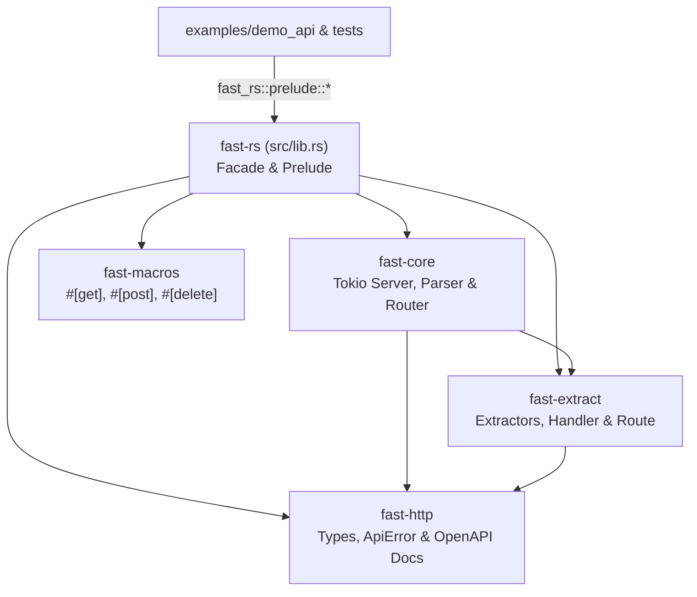

# fast-rs Architecture

This document describes the internal design of **fast-rs**, how its four workspace crates cooperate, and the compile-time and runtime guarantees enforced across the request pipeline.

---

## 1. Workspace Dependency Graph

`fast-rs` is split into four focused crates behind a single root facade crate (`fast-rs`):



- **`fast-http`** has zero internal workspace dependencies; it defines the shared data contract (`Request`, `Response`, `Method`, `StatusCode`, `ApiError`, `RouteMeta`, OpenAPI/Swagger builders).
- **`fast-extract`** depends only on `fast-http` and owns request extraction, response conversion, variadic handler traits, and the type-erased `Route` struct.
- **`fast-macros`** is a standalone `proc-macro = true` crate using `syn`, `quote`, and `proc-macro2`. It emits code referencing `fast_rs::Route` and `fast_rs::Method` at the call site.
- **`fast-core`** depends on `fast-http` and `fast-extract` and implements the Tokio TCP server, zero-copy HTTP/1.1 parser, and slice-based router (`App`).

---

## 2. Crate-by-Crate Design

### 2.1 `fast-http` — Protocol Primitives, Errors & OpenAPI Docs

- **HTTP Types (`types.rs`):**
  - `Request` stores method, path, headers, query parameters, captured `path_params`, raw body bytes, and a `TypeId`-keyed `extensions` map (`HashMap<TypeId, Arc<dyn Any + Send + Sync>>`) for typed shared state.
  - `Request::header(&str)` performs zero-allocation case-insensitive ASCII lookup.
  - `parse_query_string(&str)` uses a lazy iterator pipeline (`split('&')`, `filter_map`, `split_once('=')`) with `%20` / `+` space decoding.
  - `Response` supports builder chaining (`with_header`, `with_cors`) and formats wire-ready HTTP/1.1 bytes (`Content-Length` + `Connection: close`) via `to_http_bytes()`.
- **Algebraic Errors (`error.rs`):**
  - `ApiError` models HTTP failure modes (`400`, `401`, `403`, `404`, `405`, `422`, `500`) as an exhaustive enum.
  - `From<serde_json::Error>` (`422`) and `From<std::num::ParseIntError>` (`400`) enable idiomatic `?` propagation inside handlers and extractors.
  - `ApiError::to_response()` serializes `{"detail": "..."}` with CORS headers attached and falls back safely without panicking.
- **OpenAPI 3.0 & Swagger UI (`docs.rs`):**
  - `build_docs_response(&[RouteMeta])` builds an OpenAPI 3.0 JSON schema on the fly—grouping multiple methods under shared URL paths, extracting `{param}` path parameters, and attaching `application/json` request body schemas for `POST`, `PUT`, and `PATCH`.
  - `build_swagger_html()` serves a compile-time `const` HTML page pointing Swagger UI at `/openapi.json`.

---

### 2.2 `fast-extract` — Typed Extractors & Variadic Handlers

- **Traits (`extract.rs`):**
  - `FromRequest::from_request(req: &Request) -> Result<Self, ApiError>` borrows the incoming request so multiple extractors (`State<T>`, `Path<T>`, `Json<T>`, or raw `Request`) can run in any order on the same handler.
  - `IntoResponse` converts `Response`, `ApiError`, `String`, `&'static str`, `Json<T>`, `(StatusCode, ...)`, and `Result<T, E>` (where `E: Into<ApiError>`) into concrete HTTP responses.
- **Variadic `Handler<Args>` & Type Erasure (`handler.rs`):**
  - Every `async fn` in Rust produces a distinct anonymous `Future` type and may take different extractor counts.
  - `Handler<()>` handles 0-argument endpoints, while `macro_rules! impl_handler` stamps out `Handler<(T1,)>`, `Handler<(T1, T2,)>`, and `Handler<(T1, T2, T3,)>` at compile time.
  - Generated `call()` methods run `T::from_request(&req)` sequentially and short-circuit immediately to `err.to_response()` if any extractor fails.
  - `Route::new` erases concrete handler types into `BoxedHandler` (`Arc<dyn Fn(Request) -> Pin<Box<dyn Future<Output = Response> + Send + 'static>> + Send + Sync>`) alongside `Method`, `path`, and `handler_name`.

---

### 2.3 `fast-macros` — Compile-Time Route Decorators

`#[get("/path")]`, `#[post("/path")]`, and `#[delete("/path")]` share one internal `expand_route` compiler pass:

1. Parses the attribute argument as a `syn::LitStr` and the target item as a `syn::ItemFn`.
2. Verifies `func.sig.asyncness.is_some()`—emitting a spanned compile error on `fn` if a handler is not `async`.
3. Moves the original async function privately inside a zero-argument factory function that constructs and returns `fast_rs::Route`.

**Example Expansion:**

```rust
// Input
#[get("/tasks/{id}")]
pub async fn get_task(Path(id): Path<u32>) -> Result<Json<Task>, ApiError> {
    ...
}

// Generated at compile time
pub fn get_task() -> fast_rs::Route {
    async fn __fast_handler(Path(id): Path<u32>) -> Result<Json<Task>, ApiError> {
        ...
    }

    fast_rs::Route::new(
        fast_rs::Method::Get,
        "/tasks/{id}",
        "get_task",
        __fast_handler,
    )
}
```

---

### 2.4 `fast-core` — Zero-Copy Parser, Router & Tokio Server

- **Zero-Copy HTTP/1.1 Parser (`parser.rs`):**
  - `parse_borrowed<'head, 'a>` parses raw TCP bytes using `httparse::Request` over stack-allocated header slots (`MAX_HEADERS = 64`), returning slices borrowing directly from the read buffer before constructing `Request`.
  - Enforces strict framing bounds (`MAX_HEAD_BYTES = 8 KiB`, `MAX_BODY_BYTES = 1 MiB`) and rejects non-origin-form targets, fragments (`#`), invalid UTF-8 header values, duplicate/malformed `Content-Length`, and unsupported `Transfer-Encoding`.
  - Returns `Ok(None)` when headers or body bytes are still incomplete so the server loop can keep reading fragmented TCP packets.
- **Router & App State (`router.rs`):**
  - `App::register(fast_extract::Route)` adapts macro-generated routes cleanly into `App::route(RouteMeta, BoxedHandler)`.
  - `App::dispatch` reserves `GET /docs` and `GET /openapi.json` (deduplicating shadowed route templates in OpenAPI output), prioritizes exact literal paths over dynamic `{param}` templates, captures path parameters only on full segment matches, injects `Arc` shared state into `req.extensions`, and invokes the matched `BoxedHandler`.
- **Async TCP Server (`server.rs`):**
  - `App::run` binds a `tokio::net::TcpListener`, wraps `App` in `Arc`, and spawns one Tokio task per accepted connection.
  - Handles transient OS accept errors (`Interrupted`, `ConnectionAborted`, `ConnectionReset`, Linux pending network errors) and backs off cleanly on file descriptor / memory pressure (`EMFILE`, `ENFILE`, `ENOBUFS`, `OutOfMemory`).
  - Applies 10-second read/write deadlines (`READ_DEADLINE`, `WRITE_DEADLINE`), logs `<METHOD> <PATH> <STATUS> <LATENCY>` to `stderr`, and drains unread bytes briefly after shutdown (`CLOSE_DRAIN_DEADLINE`) so early `400` responses are not lost to TCP resets.

---

## 3. Intentional Scope & Design Trade-Offs

To keep the framework focused, readable, and easy to verify end-to-end:

| Area                | Current Behavior                                                                                             | Rationale                                                                                                             |
| :------------------ | :----------------------------------------------------------------------------------------------------------- | :-------------------------------------------------------------------------------------------------------------------- |
| **HTTP Framing**    | HTTP/1.1 with `Connection: close` and `Content-Length`; `Transfer-Encoding: chunked` is rejected with `400`. | Eliminates request-smuggling edge cases while keeping zero-copy parsing auditable.                                    |
| **Handler Arity**   | Supports 0 to 3 `FromRequest` parameters via `impl_handler!`.                                                | Covers standard CRUD endpoints (`State`, `Path`, `Json`); easily extended by adding `impl_handler!(T1, T2, T3, T4);`. |
| **Path Extraction** | `Path<T>` extracts the first captured `{param}` segment via `FromStr`.                                       | Keeps single-parameter REST routes (`/tasks/{id}`) minimal without tuple-path macros.                                 |
| **OpenAPI Schema**  | Auto-discovers paths, methods, `{param}` parameters, and generic JSON request bodies.                        | Avoids requiring a custom `JsonSchema` derive macro on user DTO structs.                                              |
